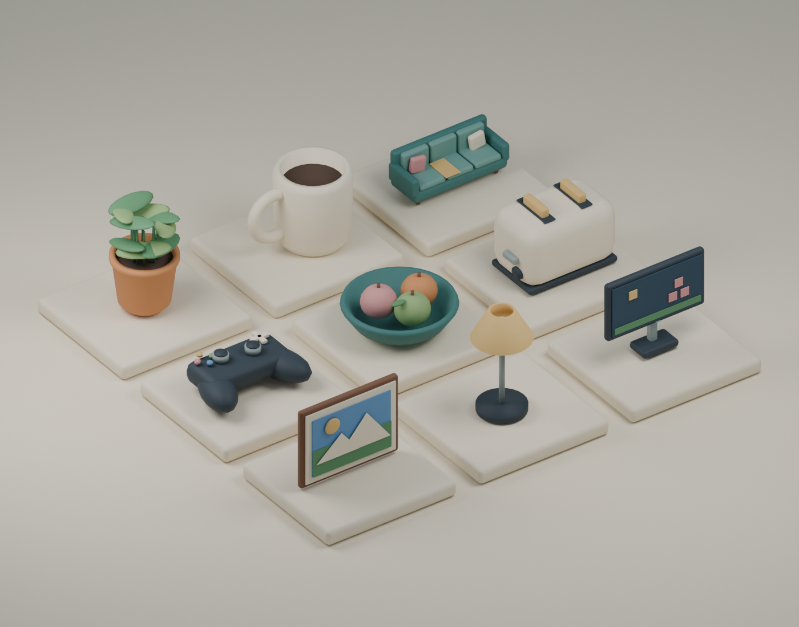

# Blender art pass and Studio import

The house now has two layers of improvement:

- **Available immediately in the Rojo build:** muted sage/cream/terracotta colors, fabric surfaces, rounded native mugs/pillows/pots, curtains with folds, ceiling trim, and warm room/lamp lights.
- **Ready for Studio import:** nine original Blender models with beveled edges, smooth curves and a shared packed color texture. These are not yet installed in the Roblox place.

The preview is a Blender render of the actual mesh kit, not a Roblox screenshot:



## Files

- `assets/blender/HouseDetailKit.blend`: editable Blender 5.1 source, with packed palette texture and preview scene.
- `assets/blender/HouseDetailKit.fbx`: all nine named meshes in one import.
- `assets/blender/HousePalette.png`: shared color texture, also embedded in the FBX.
- Individual FBX files: Sofa, CeramicMug, PottedFern, Toaster, FruitBowl, GameController, GamingMonitor, DeskLamp and PictureFrame.
- `assets/blender/manifest.json`: per-mesh dimensions and triangle counts.
- `src/server/ArtPlacements.luau`: 16 intended placements and native parts to conceal after successful replacement.

The full unique kit is 14,906 triangles; the largest mesh is the fern at 3,512. Instancing multiple props increases scene geometry; mobile performance is not yet measured.

## Required Studio actions, in order

1. **Stop Play, then sync Rojo.** The new ServerStorage.DetailAssets folder and placement module must exist before import. Save unrelated Studio work first.
2. **Open Home → Import** (the 3D Importer) and choose `C:\Projects\Roblox Game\assets\blender\HouseDetailKit.fbx`. This imports the authored mesh kit; it does not alter the house geometry.
3. **Inspect the importer preview.** Keep all nine objects separate and preserve their names. Confirm upright orientation, texture colors and any importer warnings. Do not merge everything into one mesh. For a local preview, disable Upload To Roblox if that option is available. Do not publish the experience just to preview the kit.
4. **Import, then move the resulting model into ServerStorage.DetailAssets.** Its descendants must include exactly named mesh/model sources such as Sofa, CeramicMug and GamingMonitor. The display-grid positions are intentional; the placement module normalizes them.
5. **Press Play.** The server clones the imported meshes to 16 positions and hides only matching original visuals. Check Output for `[Art] Placed 16/16 mesh details`. A missing asset leaves its native prop visible, so a partial import does not remove furniture.
6. **Inspect the replacements.** Check sofa seating/collision alignment, plant positions, mug placement, picture orientation, screen direction, lighting and camera behavior. The original sofa collision proxy remains; the mesh is visual and may need alignment tuning.
7. **Optional edit-mode preview:** stop Play, open Studio's Command Bar, and run the one line below. It applies the same placement while editing and can be run again after reimporting. Reapply after source sync if sync restores native transparency.
8. **Preserve the import for reproducible builds.** For portable/published use, upload the mesh/texture assets under the correct experience owner through Studio and verify permissions. Save the imported kit from Studio as `assets/imported/HouseDetailKit.rbxm`, then rebuild. Local-only imports may use temporary content and are not a portable asset delivery. Do not export the entire live Workspace into this folder.

```lua
require(game.ServerScriptService.Server.ArtDetailService).apply()
```

`DetailAssets` and `MeshDetails` allow unknown instances during Rojo sync to preserve Studio-imported objects. Only an exported source bundle with valid asset references makes a fresh CLI build include the meshes.

These steps follow Roblox's [3D Importer documentation](https://create.roblox.com/docs/studio/importer). Native Studio UI automation is unavailable in the current agent session; the import, Roblox asset ownership/permissions, and playtest have **not** been performed.

## Regenerate and validate

From the repository root:

```powershell
& 'C:\Program Files\Blender Foundation\Blender 5.1\blender.exe' --background --python scripts\build_blender_details.py
& 'C:\Program Files\Blender Foundation\Blender 5.1\blender.exe' --background --python scripts\validate_blender_details.py
.\scripts\Build.ps1
```

The generator creates meshes, palette texture, individual FBXs, combined FBX, blend source, manifest and rendered preview. The validator imports the combined FBX into a temporary Blender scene and checks object names, triangle counts, UVs, texture data and positive dimensions. Neither test proves the Roblox importer behaves identically.

All models and artwork are authored locally. No downloaded Toolbox models, texture packs, character scripts, gameplay changes or paid dependencies were added.
